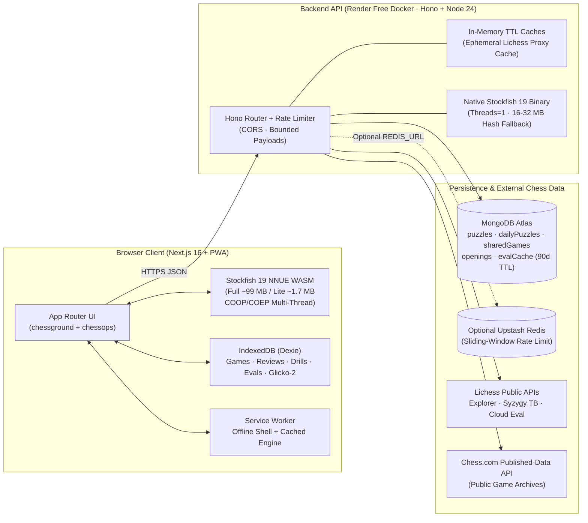

# Kingside

**Free, open-source chess analysis, match review, puzzles, openings, bots, and endgame training.**
No accounts, no paywalls, and no trackers — powered by Stockfish 19 NNUE running directly in your browser.

`Copyright (c) 2026 Debmalyo Barman` · Licensed under **[AGPL-3.0-or-later](LICENSE)**

---

## Architecture

Kingside uses a privacy-first hybrid architecture: heavy engine computation runs locally in WebAssembly inside the user's browser, backed by a lightweight Docker API for game imports, shared position caching, Lichess API proxying, puzzle delivery, link sharing, and a bounded server-side Stockfish 19 micro-fallback for constrained mobile browsers.



---

## Features Implemented

### 1. Live Analysis Board (`/analysis`)
- Interactive `chessground` board with `chessops` move trees, nested variations, PGN/FEN import & export, and typed SAN move input (`Nf3`, `O-O`, `e8=Q`).
- In-browser **Stockfish 19 NNUE** Web Worker with **Lite** (~1.7 MB) and **Full** (~99 MB) net switching, `MultiPV` (1–5 lines), pace presets (`16`, `24`, `32`, or infinite depth), eval bar, best-move arrow, and click-to-play continuation lines.
- Integrated **Opening Explorer** (Masters, Lichess Online, and bundled CC0 opening book fallback) and **7-Piece Syzygy Endgame Tablebase** panel (`TB` badge, WDL + DTZ/DTM).
- 10 custom board color palettes, 14 SVG piece sets, SAN / figurine (`♞e5`) notation, and Web Audio API synthesized sound effects.

### 2. Match Analysis (`/review`)
- Import public games by **Chess.com** or **Lichess** username, paste PGNs, or upload `.pgn` files (with `[%clk]` move-time parsing).
- Node-budgeted presets (**Fast** `150k`, **Standard** `400k`, **Deep** `1.5M` nodes) ensuring deterministic verdicts regardless of hardware speed.
- **Dual Scoring Metrics** (toggleable in review options and settings):
  - **Classic Accuracy:** Lichess `AccuracyPercent` expected-score curve and volatility-weighted harmonic/arithmetic mean.
  - **Kingside Precision:** Clean-room complexity-calibrated score using label-curve expected-points loss (`PRECISION_DECAY = 6.25`) and a generalized power mean (`p = -0.75`).
- **Tactical Guide & Classifications:** Move verdicts (`Forced`, `Book`, `Brilliant`, `Great`, `Best`, `Excellent`, `Good`, `Inaccuracy`, `Mistake`, `Miss`, `Blunder`), phase accuracy breakdown (Opening / Middlegame / Endgame), ACPL, PGN-anchored performance estimate, interactive eval graph, threat arrows, **Retry Mistakes** with progressive hints, and automatic drill creation.

### 3. Tactical Puzzles (`/puzzles`, `/puzzles/daily`)
- Powered by the CC0 Lichess puzzle database (`puzzles` & `dailyPuzzles` MongoDB collections, filtered to high-quality puzzles with popularity ≥ 85 and ≥ 300 plays).
- Modes: **Rated** (device-local Glicko-2 rating starting at `1500 ± 350`), **Streak**, **3-Minute Rush** (Timed), and a deterministic UTC **Daily Puzzle**.
- Filter across **32 tactical & endgame themes**; accepts any legal checkmate move.

### 4. Play vs. Bots (`/play`)
- **10 original bot personas** spanning ~400 (`Pip`) to 2800 (`Atlas`) plus full-strength Stockfish 19 (`Kingside Max`), each with custom avatar art and opening-book repertoire variety.
- Supports Untimed, `3+2`, `5+3`, `10+0`, and `15+10` time controls, hints, takebacks, resignation, and one-click post-game Match Analysis.

### 5. Practice & Mistake Drills (`/practice`, `/practice/drills`)
- **27 curated practice positions** across 6 categories (*Basic Checkmates*, *Mating Patterns*, *Tactics*, *Pawn Endgames*, *Piece Endgames*, *Defence*) played live against Stockfish with goal verification.
- **Mistake Drills:** Mistakes, misses, and blunders from your reviewed games automatically enter a local **Leitner spaced-repetition queue** (`1 → 3 → 7 → 16 → 35` day intervals) with full promotion and checkmate/stalemate recognition.

### 6. Standalone Openings, Endgames & Board Editor (`/openings`, `/endgames`, `/editor`)
- Dedicated **Opening Explorer** (`/openings`) and **7-Piece Syzygy Tablebase** (`/endgames`) explorers.
- Full **Board Editor** (`/editor`) supporting piece placement, castling rights, en passant square, side to move, move counters, FEN copy, and direct launch into live analysis.

### 7. Local Library, Insights, 10 Share Formats & PWA (`/library`, `/insights`, `/g/<id>`, `/embed/g/<id>`)
- **Local Library & Insights:** On-device IndexedDB storage deduplicated by 64-bit FNV-1a `pgnHash`, multi-select deletion, bulk PGN export, accuracy trends, phase/color splits, and opening performance charts.
- **10 Ways to Share:** Short persistent links (`/g/<id>`, 1-year TTL in `sharedGames`), move-anchored links (`/g/<id>#N`), responsive `<iframe>` embeds (`/embed/g/<id>`), OS Web Share sheet (links & PNGs), Copy PGN, Download `.pgn`, Copy FEN, `/analysis?fen=` links, 1024 px board PNG export, and animated game GIF generation (up to 400 frames).
- **Offline PWA:** Hand-written Service Worker (`frontend/public/sw.js`) caches the app shell, opening book, piece SVGs, and Stockfish WASM for offline `/analysis`.

---

## Engine & Analysis Methodology

Kingside documents all evaluation formulas and provenance in [docs/ALGORITHMS.md](docs/ALGORITHMS.md) and [docs/adr/0005-phase2-hybrid-engine-and-precision.md](docs/adr/0005-phase2-hybrid-engine-and-precision.md):

1. **Two-Pass Hybrid Pipeline:**
   - **Pass 1 (`MultiPV = 1`):** Opening positions (first 20 plies) query ephemeral `/api/cloud-eval` (`depth >= 30`). Remaining positions check browser IndexedDB and batch `POST /api/eval-cache/lookup`, then evaluate misses in reverse game order so Stockfish transposition tables stay warm (falling back to `/api/engine/eval` on mobile browsers without working WASM/Workers).
   - **Pass 2 (`MultiPV = 3` at `4×` nodes):** Up to 24 `criticalPositions` (sacrifices, errors, turning points, non-obvious best moves, `≥ 8%` win swings) are re-searched with 3 candidate lines, plus a `depth = 2` shallow surprise probe (`arXiv:2406.11895`) on sacrifice candidates.
2. **Bitboard SEE & Tactical Motifs:** `packages/chess-core/src/see.ts` implements full Static Exchange Evaluation (`seeGe` / `seeValue`) using `chessops` attack/ray bitboards with slider X-rays, promotions, en passant, and absolute king-pin checks. `explain.ts` surfaces up to two structured reasons per move (`mates`/`allowsMate`/`missedMate`, `hangs`, `allowsFork`, `pins`/`allowsPin`, `skewers`/`allowsSkewer`, `discoveredAttack`/`allowsDiscoveredAttack`, `doubleCheck`/`allowsDoubleCheck`, `trapsPiece`/`trappedPiece`, `backRank`/`allowsBackRank`, `deflection`/`allowsDeflection`, and `missedTactic`).
3. **Strict Legal Cache Separation:** Third-party Lichess `cloud-eval` lines stay strictly ephemeral in backend RAM (`TtlCache`) and browser IndexedDB (`lichess-cloud`). MongoDB `evalCache` (90-day TTL, normalized 4-field EPD keys, legal-PV checked) stores strictly Kingside's own Stockfish 19 evaluations (`isKingsideEngineTag`).

---

## Monorepo Layout

```text
kingside/
├── frontend/               # Next.js 16 App Router UI, Stockfish 19 WASM worker, Dexie DB, PWA
├── backend/                # Hono API server, Dockerfile (Node 24 + Stockfish 19), esbuild bundle
├── packages/
│   ├── chess-core/         # Pure TS review engine, accuracy/precision, bitboard SEE, tactics, bots, Glicko-2
│   ├── db/                 # Mongoose schemas, EvalCache/Puzzle/SharedGame queries & CLI scripts
│   ├── uci/                # Zero-dependency UCI info/bestmove parser
│   └── config/             # Shared TypeScript presets
├── docs/                   # Algorithms, licensing guidance, roadmap, and ADRs
├── render.yaml             # Render Free Docker Blueprint for @kingside/backend
└── THIRD_PARTY_NOTICES.md  # Full runtime dependency, font, asset, and data attributions
```

---

## Local Development Setup

### Prerequisites
- **Node.js `>= 24`** (see [`.node-version`](.node-version))
- **pnpm `12.14.0`** (`corepack enable`)
- A **MongoDB Atlas** cluster (or local Docker via `docker compose up -d` for MongoDB 8 + Valkey 8)

### 1. Clone & Install

```bash
git clone https://github.com/<YOUR_GITHUB_USERNAME>/kingside.git
cd kingside
pnpm install
```

`pnpm install` runs `@kingside/frontend`'s `postinstall` script (`frontend/scripts/copy-engine.mjs`), copying the Stockfish 19 WASM/JS workers into `frontend/public/engine/`.

### 2. Configure Environment Files

```bash
cp backend/.env.example backend/.env
cp frontend/.env.example frontend/.env.local
```

Edit `backend/.env` with your MongoDB URI (`MONGODB_URI`, `MONGODB_DB="kingside"`) and `API_CONTACT`. See [`backend/.env.example`](backend/.env.example) and [`frontend/.env.example`](frontend/.env.example) for all optional flags (`LICHESS_TOKEN`, `REDIS_URL`, `SERVER_ENGINE_ENABLED`, `NEXT_PUBLIC_SOURCE_URL`).

### 3. Create Indexes & Optional Puzzle Import

```bash
# Create MongoDB indexes (TTL + compound puzzle indexes)
pnpm db:indexes

# Optional: import CC0 Lichess puzzles into MongoDB
# pnpm import:puzzles
```

### 4. Run Dev Servers

```bash
# Run all workspace dev tasks via Turborepo
pnpm dev

# Or run API and Web in separate terminals
pnpm --filter @kingside/backend dev    # http://localhost:8787
pnpm --filter @kingside/frontend dev   # http://localhost:3000

# Or from inside each workspace folder
cd backend && pnpm dev
cd frontend && pnpm dev
```

### 5. Lint, Typecheck & Production Build

```bash
pnpm lint
pnpm -r typecheck
pnpm --filter @kingside/backend build
pnpm --filter @kingside/frontend build
```

---

## Self-Hosting & Production Deployment

Kingside is structured for a split zero-cost cloud deployment:

| Component | Target | Notes |
|---|---|---|
| **Database** | **MongoDB Atlas** (M0 Free) | Create a least-privilege `readWrite` user scoped to the `kingside` DB and run `pnpm db:indexes`. |
| **Backend API** | **Render** (Free Docker Web Service via [`render.yaml`](render.yaml)) | Builds [`backend/Dockerfile`](backend/Dockerfile) (`node:24-slim` + SHA-256 verified Stockfish 19 universal binary, non-root user `kingside`). Caps server Stockfish (`Threads=1`, `Hash=16-32 MB`, `maxQueue=4`) to stay within 512 MB RAM. |
| **Rate Limit Store** | **Upstash Redis** (Optional) | Set `REDIS_URL` (`rediss://...`) for shared sliding-window limits; automatically falls back to LRU+expiry in-memory limiting when blank. |
| **Frontend Web** | **Vercel** (Root Directory: `frontend`) | Enable **"Include files outside the root directory"** so `@kingside/*` workspace packages resolve. Set `NEXT_PUBLIC_API_URL` to your Render HTTPS URL and `NEXT_PUBLIC_SOURCE_URL` to your public repository URL. |

> **Important Cross-Origin Isolation Note:** `frontend/next.config.ts` sets `Cross-Origin-Opener-Policy: same-origin` and `Cross-Origin-Embedder-Policy: require-corp` so browsers enable `SharedArrayBuffer` for multi-threaded Stockfish 19 WASM, alongside strict `Content-Security-Policy` headers (`connect-src` scoped to `'self'` and `NEXT_PUBLIC_API_URL`). Ensure `CORS_ORIGINS` on the backend matches your deployed Vercel origin.

---

## Privacy, Security & Licensing

- **Privacy:** Kingside uses no accounts, cookies, advertising, or third-party analytics. Your games, reviews, drills, puzzle ratings, and settings live locally in browser IndexedDB (`kingside`). Data leaves your device only when you explicitly request remote imports, Lichess Explorer/Tablebase/Cloud-Eval lookups, shared `EvalCache` caching, or `POST /api/share` links.
- **Security:** Backend routes enforce strict `URL`-parsed `CORS_ORIGINS` validation, sliding-window rate limits, streaming byte limits on request bodies, normalized FEN/PV verification, and non-shell `child_process.spawn` execution for native Stockfish.
- **License:** `Copyright (c) 2026 Debmalyo Barman` · Licensed under **GNU Affero General Public License v3.0 or later ([`AGPL-3.0-or-later`](LICENSE))**. Under AGPL-3.0 §13, deployers exposing modified network versions should set `NEXT_PUBLIC_SOURCE_URL` so users can access the Corresponding Source.
- **Third-Party Attributions:**
  - **[Stockfish 19 (`sf_19`)](https://github.com/official-stockfish/Stockfish/tree/sf_19)** — GPL-3.0
  - **[stockfish.js (`19.0.1`)](https://github.com/nmrugg/stockfish.js)** — GPL-3.0 (engine) / MIT (wrapper)
  - **[chessground (`9.2.1`)](https://github.com/lichess-org/chessground)** — GPL-3.0-or-later
  - **[chessops (`0.15.1`)](https://github.com/niklasf/chessops)** — GPL-3.0-or-later
  - **[lichess.org](https://lichess.org)** — Opening Explorer, 7-Piece Syzygy Tablebase, Cloud Eval API terms, and CC0 datasets (puzzles & `chess-openings`)
  - Complete dependency, font, and asset table in [`THIRD_PARTY_NOTICES.md`](THIRD_PARTY_NOTICES.md) and guidance in [`docs/LICENSING.md`](docs/LICENSING.md).
